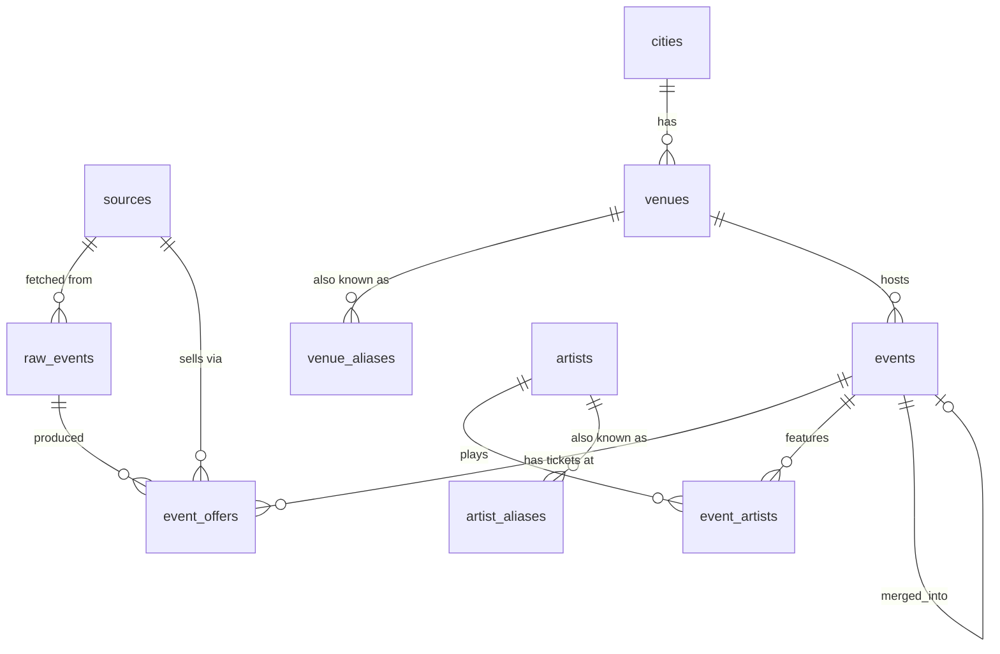

# Data model



## Data flow

```
collector ──► raw_events ──► normalizer ──► events + event_offers + artists/venues
 (Epic 4)     (as scraped)    (Epic 5)            (deduplicated in Epic 6)
```

`raw_events` is the source of truth for what a site said. If the normalizer has a
bug, fix it and reprocess the stored payloads; no need to scrape again.

## Decisions

| Topic | Decision | Why |
|---|---|---|
| Names | `name_norm` generated column: lower-case, accent-free, single-spaced (`norm_name()`) | "Évora" = "evora"; matching and unique constraints ignore accents and case |
| Fuzzy search | `pg_trgm` GIN indexes on `name_norm` and event titles | typo-tolerant lookup for the normalizer and for search |
| Renamed venues | `venue_aliases` | Pavilhão Atlântico → Altice Arena → MEO Arena; each site uses a different one |
| Money | integer cents + `currency` (default EUR); `NULL` = unknown, `0` = free | no floating-point errors; "unknown" is not "free" |
| Time | `start_at timestamptz` (UTC) + `local_date` set by the normalizer | Azores are UTC-1; day-based filters use the venue's local date |
| Timezones | `cities.timezone` (`Europe/Lisbon`, `Atlantic/Madeira`, `Atlantic/Azores`) | render times correctly everywhere in Portugal |
| Status | `scheduled / cancelled / postponed / sold_out` | cancellations must be visible, not silently dropped |
| Duplicates | `events.fingerprint` (indexed, **not** unique) and `merged_into` | matching is probabilistic, so merges are recorded and reversible |
| Auto-created rows | `verified = false` on venues and artists | collectors can create them; a human can review later |
| Raw payloads | unique on `(source, external_id, payload_hash)` | unchanged re-fetches store nothing new |
| Offers | unique on `(source, external_id)`, `last_seen_at` | upsert on every crawl; stale `last_seen_at` hints at a cancelled listing |

## Migrations

- Plain SQL files in `services/migrate/migrations/`, applied in filename order.
- Each runs in its own transaction; a failure rolls back that file completely.
- Applied migrations are checksum-verified. **Never edit an applied migration**; add a new one (`004_...sql`).
- An advisory lock prevents two migrate runs from colliding.
- Seeds (`services/migrate/seeds/`) are idempotent and run on every start.
- Seed coordinates are approximate and get refined by the geocoder in Epic 5.
